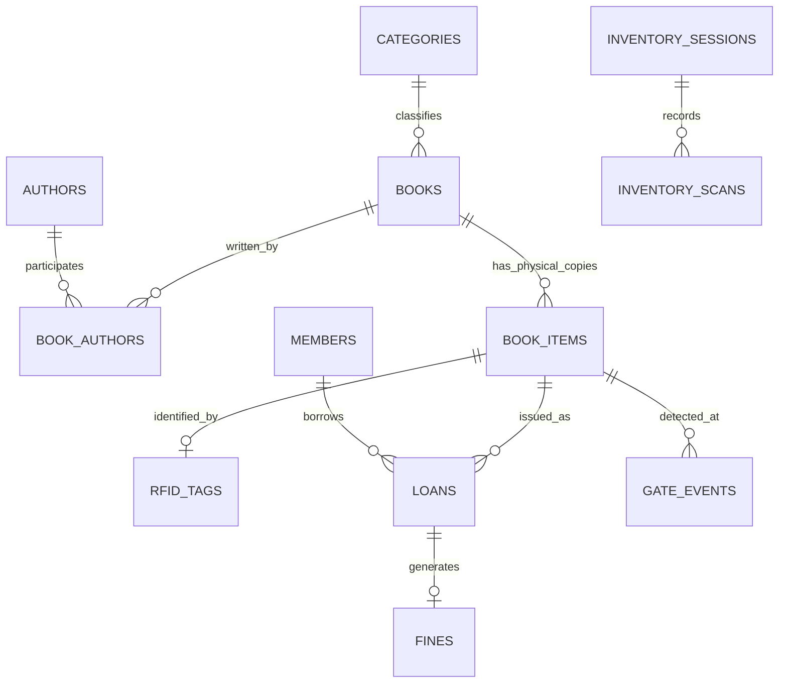

# AISYS RFID Library Intelligence OS — Database Design & Data Dictionary

## 1. Schema Overview

The database comprises 21 relational tables designed for normalization, auditability, and ACID compliance under SQLite WAL mode.

---

## 2. Relational Table Specifications

### 2.1 Cataloguing & Physical Inventory
- **`books`**: Bibliographic metadata (`isbn`, `title`, `subtitle`, `publisher`, `year`, `category_id`, `language`, `edition`, `pages`, `is_reference`).
- **`book_items`**: Individual physical copies (`accession_number`, `barcode`, `shelf_location`, `status`: Available, Issued, Missing, Damaged, Reference Only).
- **`categories`**: Dewey/LC thematic classifications (`code`, `name`, `description`).
- **`authors`**: Contributor details (`name`, `biography`).
- **`book_authors`**: Many-to-many junction table between `books` and `authors`.

### 2.2 Patrons & Circulation
- **`members`**: Library patrons (`membership_number`, `full_name`, `email`, `phone`, `department`, `membership_type`, `expiry_date`, `status`: Active, Blocked, Expired, `outstanding_fine`).
- **`loans`**: Borrowing transactions (`loan_number`, `member_id`, `item_id`, `issue_date`, `due_date`, `return_date`, `renewal_count`, `status`: Issued, Overdue, Returned).
- **`fines`**: Overdue penalties assessed per circulation policy (`loan_id`, `member_id`, `amount`, `paid_amount`, `status`: Pending, Paid).

### 2.3 RFID Middleware & Hardware Telemetry
- **`rfid_tags`**: Tag transponder mapping (`tag_uid`, `item_id`, `tag_type`, `security_bit`: 1 = Armed, 0 = Cleared, `status`: ACTIVE, RETIRED).
- **`inventory_sessions`**: Handheld audit sweeps (`shelf_location`, `total_expected`, `total_found`, `total_missing`, `total_misplaced`, `status`).
- **`inventory_scans`**: Item-level transponder scan logs (`session_id`, `tag_uid`, `scan_result`: FOUND, MISPLACED, MISSING).
- **`gate_events`**: Security pedestal portal detections (`event_id`, `tag_uid`, `accession_number`, `gate_location`, `auth_result`, `alarm_status`, `cctv_reference`).

### 2.4 Governance, Migration & System Audit
- **`audit_logs`**: Immutable security log (`username`, `action`, `resource`, `resource_id`, `details`, `ip_address`, `created_at`).
- **`migration_jobs`**: 20k staging jobs (`batch_id`, `filename`, `total_rows`, `valid_rows`, `invalid_rows`, `status`).
- **`migration_rows`**: Raw staging buffer (`job_id`, `row_number`, `data_json`, `validation_errors`, `status`).
- **`library_settings`**: Key-value operational parameters (`LOAN_DURATION_DAYS`, `MAX_FINE_BLOCK_THRESHOLD`, etc.).
