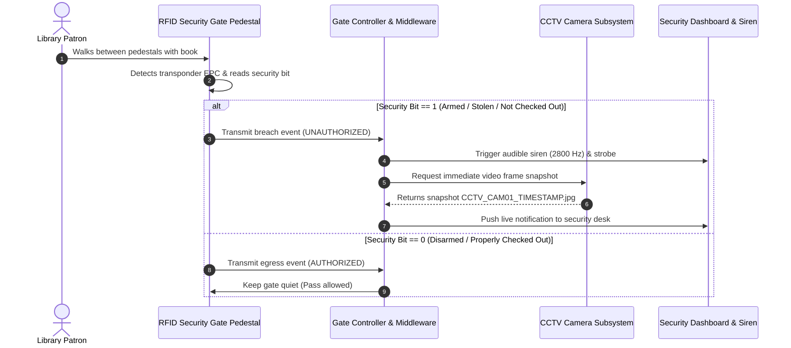

# AISYS RFID Library Intelligence OS — RFID Middleware & Hardware Integration

## 1. Hardware Architecture & Standards

AISYS supports device-neutral hardware integration across ISO/IEC and EPCglobal industry standards:

| Component | Standard | Operating Frequency | Read Range | Primary Function |
| :--- | :--- | :--- | :--- | :--- |
| **Book Transponder Tag** | ISO 18000-6C / EPC Gen2 | 865–928 MHz (UHF) | 0.5m – 4.0m | Book item tracking & security |
| **Staff Desktop Reader Pad** | ISO 18000-6C / ISO 15693 | UHF / 13.56 MHz HF | 0.05m – 0.3m | Fast checkout, checkin & tag encoding |
| **Handheld Inventory Wand** | ISO 18000-6C Gen2 | 865–928 MHz | 1.0m – 3.0m | Rapid shelf inventory audits & search |
| **Anti-Theft Security Gate** | ISO 18000-6C Dual Pedestal | 865–928 MHz | 0.9m – 1.8m aisle | Theft prevention & egress monitoring |
| **Patron Smart Card** | ISO/IEC 14443A (Mifare) | 13.56 MHz HF | 0.02m – 0.05m | Contactless patron authentication |

---

## 2. Tag Memory Bank Layout (EPC Gen2)

The 96-bit to 128-bit transponder memory is partitioned into four banks:

1. **Bank 00 (Reserved)**: Kill password (32-bit) and Access password (32-bit).
2. **Bank 01 (EPC)**: Electronic Product Code encoding the unique library identifier, category code, and item accession sequence.
3. **Bank 10 (TID)**: Unique silicon serial burned into the microchip at manufacture.
4. **Bank 11 (User Memory / EAS)**: Holds the Electronic Article Surveillance (EAS) security bit:
   - `security_bit = 1`: **ARMED**. Item belongs inside library. Passing the security gate triggers audible siren and strobe alarm.
   - `security_bit = 0`: **DISARMED / CLEARED**. Item is legitimately checked out to a patron. Passing the security gate is quiet and permitted.

---

## 3. Security Gate Egress Decision Flow

